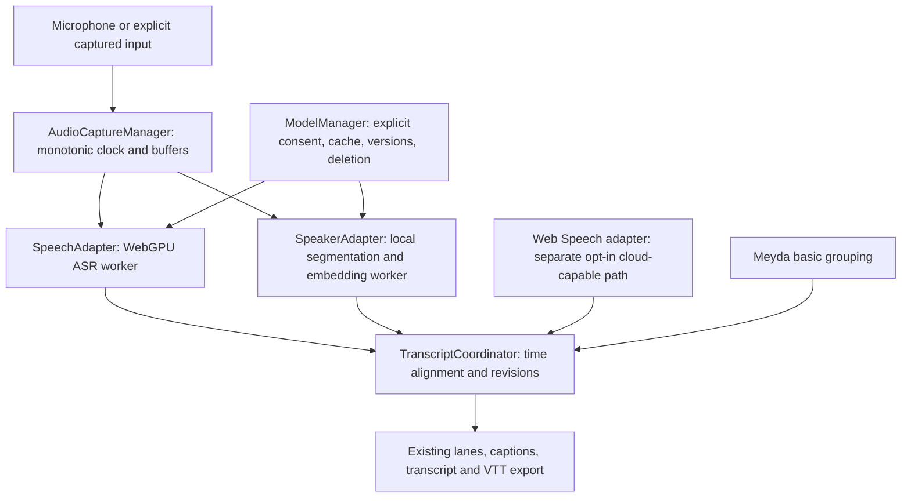

# Architecture and interfaces

> **Implemented today (2026-11-10):** there is no separate
> `AudioCaptureManager` module — capture lives in `setupAudio()` in `app.js`;
> `SpeechEngine` is the browser-service adapter and also runs the experimental
> on-device engine; `TranscriptCtrl` is the coordinator; storage is the
> `Storage` object. The WebGPU ASR, advanced speaker, `ModelManager` and
> `CapabilityDetector` boxes below are the target architecture, not current
> modules.

## Data flow

Audio frame timestamps should originate at capture time from a common **monotonic timebase**. Resample to each model's required input rate using explicit buffering and known start offsets. Avoid using `Date.now()` for relative segment alignment. Distinguish microphone capture time from inference completion time. Bound queue sizes to avoid out-of-memory failures.

## Modules

- `AudioCaptureManager`: permission, selection, `AudioWorklet` if feasible, resampling, ring buffer, source/time metadata, memory controls.
- `SpeechAdapter`: start/stop, language, partial/final segment callbacks, timestamps, engine metadata, recoverable error events. Retain Web Speech adapter.
- `SpeakerAdapter`: voice activity/change candidates, overlapping speech, embedding extraction, stable within-session cluster IDs, quality signals.
- `TranscriptCoordinator`: merge timestamps and text, version segments, reconcile provisional speaker tags with later evidence, preserve manual corrections, preserve stable IDs.
- `ModelManager`: discover metadata without fetching weights, obtain consent, download, integrity and revision checks, show progress, initialize, retain/evict, delete.
- `CapabilityDetector`: secure context, mic permission availability, WebGPU adapter and limits, WASM, browser ASR, remaining storage; distinguishing advertised capability from proven model inference.
- `Storage`: keep transcript separate from model cache and speaker embeddings. Session local by default; explicit deletion controls.

## Example interfaces

See `contracts/interfaces.ts`. These are design interfaces to adapt to current JS and test conventions; do not assume TypeScript migration is required.

## Constraints

- Keep HTMX/service-worker rendering and existing UI functional during migration.
- Run model inference off the UI thread; avoid high-volume DOM/live-region updates.
- Use a single capture manager rather than multiple competing microphone streams where feasible; Web Speech may own an inaccessible separate mic pipeline, so alignment is best-effort unless a local ASR adapter is selected.
- WebGPU ASR and advanced WASM diarization are independent. Performance and memory must be tested for concurrent inference.
- Never assume Web Speech events provide reliable word timestamps.
- Keep speaker metadata in WebVTT where supported, escaping text and labels safely.
